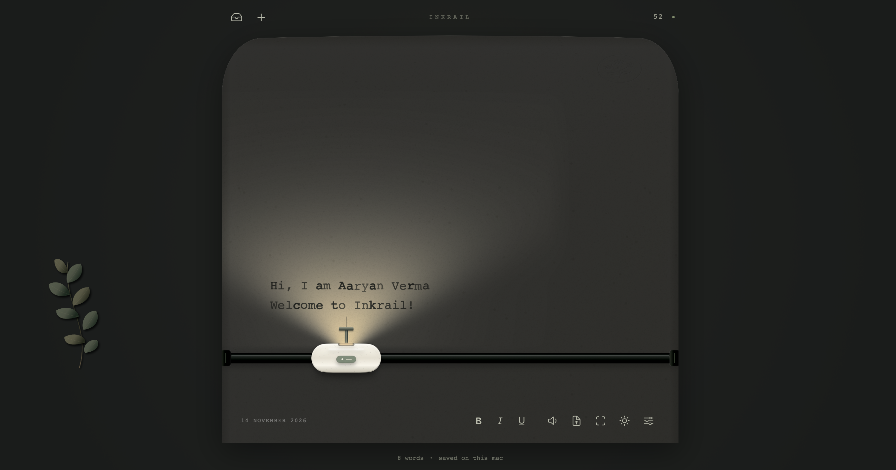
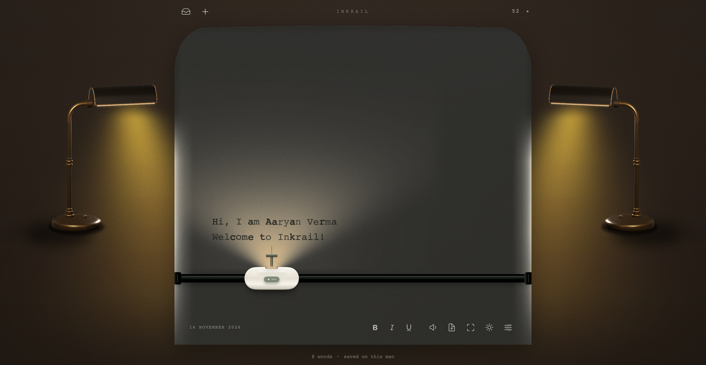
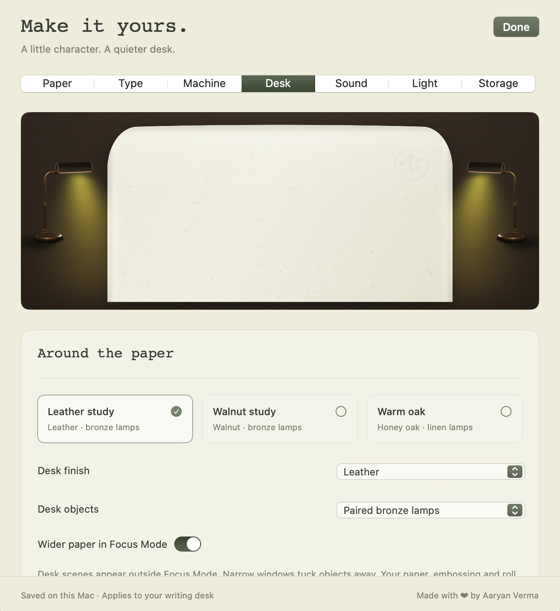

<div align="center">
  
  <h1>Inkrail</h1>
  <p><em>Paper, ink, and a little room to write.</em></p>
  <p>A quiet, offline writing desk for Mac and Windows x64. No accounts or subscriptions.</p>
  <p><a href="https://github.com/Aaryanverma/inkrail/releases/download/v0.1.1/Inkrail.zip">Download for Mac</a> · <a href="https://github.com/Aaryanverma/inkrail/releases/download/v0.1.1/Inkrail-Windows-x64.zip">Download for Windows x64</a></p>
</div>

🎥 Watch the macOS demo ↓
<p align="center">
  <a href="https://youtu.be/oanl6tyIvMo">
    
  </a>
</p>

<details>
  <summary>📸 View screenshots</summary>

  Captured on macOS.
  
  ##### Light Mode
  

  ##### Night View
  

  ##### Night View with Lamp
  

  ##### Focus Mode
  

  ##### Font Customization
  

  ##### Desk Customization
  

  ##### Machine Customization
  
</details>

## Make yourself at home

Textured paper. A small moving typewriter. Warm lamps and optional mechanical
sounds. Open **Make it yours** to choose your paper, typeface, ink and desk.
Switch to **Focus Mode** for a wider page and quieter surroundings.
In **Top** mode, the capsule and rail move below the visible writing when you
edit an earlier paragraph.

## Install directly

### macOS

The v0.1.1 download runs on Apple silicon Macs with macOS 13 or later.
Unzip the download and drag **Inkrail.app** into **Applications**.
[Download Inkrail.zip](https://github.com/Aaryanverma/inkrail/releases/download/v0.1.1/Inkrail.zip)

macOS may block this unnotarized build the first time you open it.

- In Applications, Control-click (or right-click) **Inkrail.app**, choose
**Open**, then choose **Open** again in the confirmation dialog. You only need
to do this the first time.
- If macOS does not offer that option, try opening the
app once, then go to **System Settings → Privacy & Security** and choose
**Open Anyway** for Inkrail.

### Windows

Inkrail for Windows x64 is an unsigned portable app for PCs with 64-bit Intel or AMD processors. [Download Inkrail-Windows-x64.zip from v0.1.1](https://github.com/Aaryanverma/inkrail/releases/download/v0.1.1/Inkrail-Windows-x64.zip)

1. In File Explorer, right-click **Inkrail-Windows-x64.zip** and choose **Extract All**.
2. Open **Inkrail.exe** in the extracted folder. Keep the whole folder together when moving the app.
3. If Microsoft Defender SmartScreen shows **Windows protected your PC** on first launch, select **More info**. Then select **Run anyway** at the bottom of the same dialog to open Inkrail. Windows normally remembers this choice for that copy.
4. If Inkrail reports a missing runtime, install the **Microsoft Edge WebView2 Evergreen Runtime** and reopen Inkrail. Once the runtime is installed, writing works offline. [Get WebView2 from Microsoft](https://developer.microsoft.com/microsoft-edge/webview2/)

## Build the macOS app from source

This repository contains the MIT-licensed Swift source for the Mac app. The Windows x64 app is available as a prebuilt ZIP.
To build the Mac app on macOS 13 or later with Apple's Swift 5.9+ developer tools, double-click **Launch.command** or run the following commands.

```bash
bash scripts/build-app.sh
open dist/Inkrail.app
```

See [macOS setup & troubleshooting](docs/DEVELOPMENT.md#start-on-your-mac).

## At your desk

| Action | Mac | Windows |
| :--- | :--- | :--- |
| New letter | ⌘N | Ctrl+N |
| Bold / Italic / Underline | ⌘B / ⌘I / ⌘U | Ctrl+B / Ctrl+I / Ctrl+U |
| Clear inline formatting | `⌘\` | `Ctrl+\` |
| Letter box | ⇧⌘O | Ctrl+Shift+O |
| Make it yours | ⌘, | Ctrl+, |
| Focus Mode | ⇧⌘F | Ctrl+Shift+F |
| Night writing | ⌥⌘L | Ctrl+Alt+L |
| Sound on / off | ⇧⌘M | Ctrl+Shift+M |
| Import text or Markdown | ⌘O | Ctrl+O |
| Export text | ⇧⌘E | Ctrl+Shift+E |
| Save now | ⌘S | Ctrl+S |

Use the **B**, *I*, and underline buttons at the foot of the paper to format a
selection or the words you type next. Each letter remembers its emphasis and
uses the typeface you choose in **Make it yours**.

Markdown shortcuts work as you type. Close `**bold**`, `*italic*`,
`~~strikethrough~~`, or an inline code span in backticks to apply the style.
Start a paragraph with `# ` for a heading, `> ` for a quote, or `- ` or
`1. ` for a list. The marker stays visible in normal text until you type the
first non-whitespace character. In `# Hi`, typing the `H` hides the hash and
applies the heading style. Markdown export keeps the prefix.

Writing saves automatically. If a save fails, export a copy before closing.
Open **File** on Mac or the **…** menu on Windows (**Alt+F**). Choose **Export Markdown…**
to keep formatting in a `.md` file, or **Export Text…** for plain text.
To move a letter between Mac and Windows, export it as Markdown and import it on
the other computer with **⌘O** on Mac or **Ctrl+O** on Windows.

## Your letters

Open the letter box to give a letter a searchable private title. On Mac, right-click the letter and choose **Rename…**. On Windows, select its pencil icon. Clear the title to use the opening line again.
Text and Markdown exports use the letter body and suggest a filename based on its opening line.

Inkrail saves letters locally. You can open the current library from within the app.

| Platform | Default library folder | Open the folder |
| :--- | :--- | :--- |
| macOS | `~/Library/Application Support/Inkrail/` | **Writing → Show Local Files** |
| Windows | `%APPDATA%\Inkrail\Library` | **Make it yours → Storage → Show in File Explorer** |

- To **move your library**, open **Make it yours → Storage → Change Location…** and
  choose a new or empty folder. Inkrail copies the whole library there and keeps the old copy.
- To **restore a deleted letter**, open the letter box and choose
  **Recently deleted → Restore** within **30 days**. After that window,
  Inkrail removes the deleted letter when it next checks.

Keep a separate backup of your library. [Storage & recovery on Mac and Windows →](docs/STORAGE.md)

## Inspiration

<p>Highly inspired by <a href="https://apps.apple.com/in/app/platen-paper-ink/id6809529696">Platen — Paper &amp; Ink</a> app by Rafikki Studio for iOS.<br />

> Platen app was not built for macOS & Windows, so Inkrail fills that gap with extra features that too completely free. Not sponsored by Platen.

---

<div align="center">
  <p>Made with ❤︎ by <strong><a href='https://linkedin.com/in/aaryanverma' target='_blank'>Aaryan Verma</a></strong></p>
  An independent project.</p>
  <p><a href="LICENSE">MIT License</a> · <a href="docs/DEVELOPMENT.md">Development</a></p>
</div>
