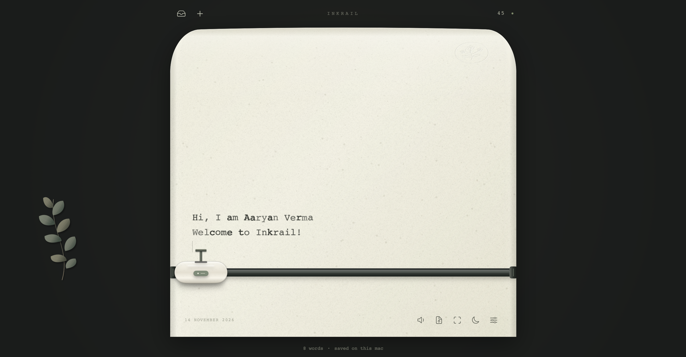
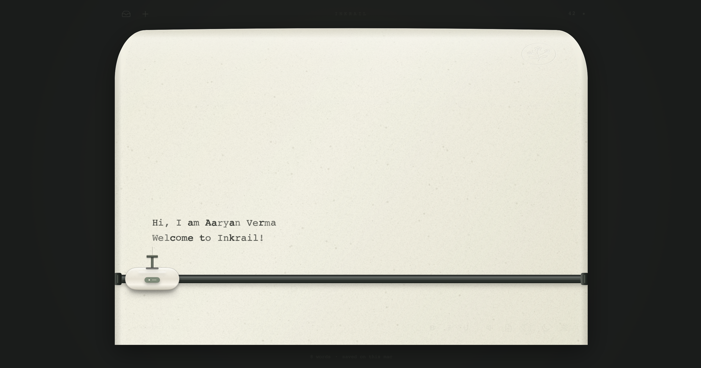
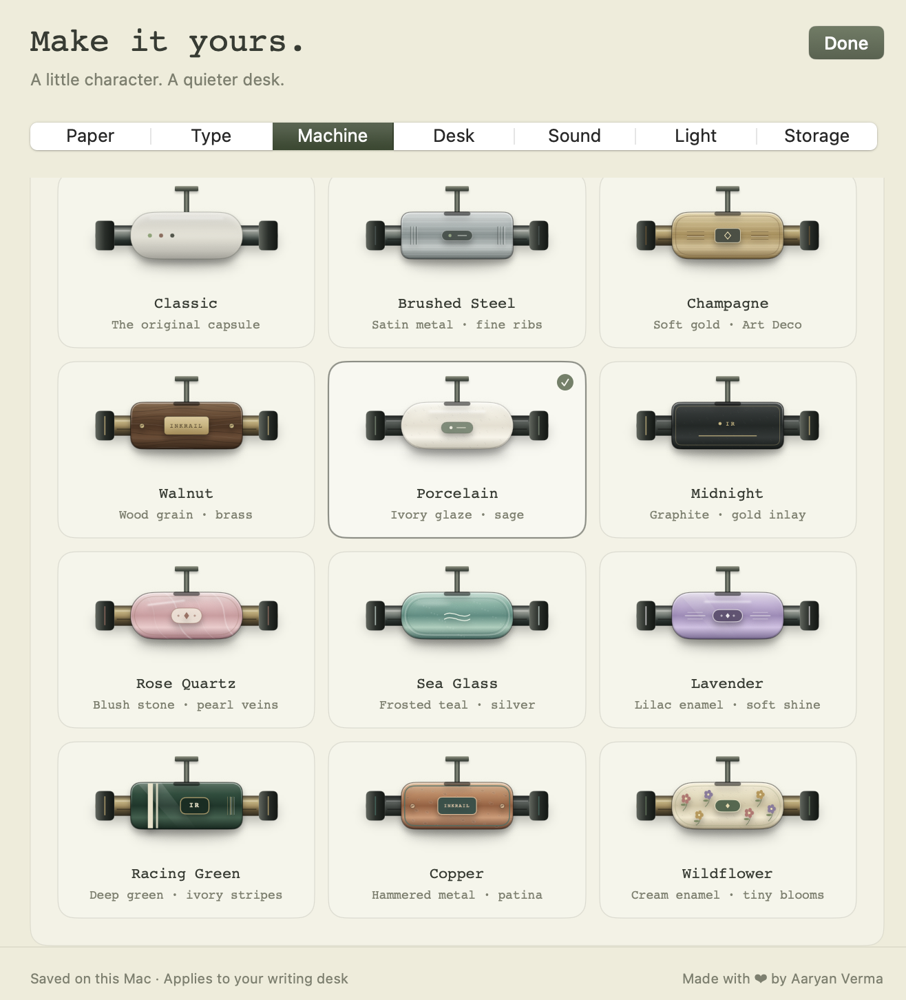

<div align="center">
  
  <h1>Inkrail</h1>
  <p><em>Paper, ink, and a little room to write.</em></p>
  <p>A quiet, native writing desk for Mac. No accounts or subscriptions.</p>
  <p><strong>macOS 13+ · Offline · Open source</strong><br /></p>
  <a href="https://github.com/Aaryanverma/inkrail/releases">
    
  </a>
</div>

🎥 View Video Demo ↓
<p align="center">
  <a href="https://youtu.be/oanl6tyIvMo">
    
  </a>
</p>

<details>
  <summary>📸 View Screenshots / Gallery</summary>
  
  ##### Light Mode
  

  ##### Night View
  

  ##### Night View with Lamp
  

  ##### Focus Mode
  

  ##### Font Customization
  

  ##### Desk Customization
  

  ##### Machine Customization
  
</details>

## Make yourself at home

Textured paper. A small moving typewriter. Warm lamps and optional mechanical
sounds. Open **Make it yours (⌘,)** to choose your paper, typeface, ink and desk.
Switch to **Focus Mode** for a wider page and quieter surroundings.
In **Top** mode, the capsule and rail move below the visible writing when you
edit an earlier paragraph.

## Install directly

Download the latest **Inkrail.app** ZIP from
[Releases](https://github.com/Aaryanverma/inkrail/releases), unzip
it, and drag **Inkrail.app** into **Applications**.

Inkrail is not notarized by Apple, so macOS may block it the first time you
open it. 
Try either of these steps:
- In Applications, Control-click (or right-click) **Inkrail.app**, choose
**Open**, then choose **Open** again in the confirmation dialog. You only need
to do this the first time. 
- If macOS does not offer that option, try opening the
app once, then go to **System Settings → Privacy & Security** and choose
**Open Anyway** for Inkrail.

## Build from source (optional)

Building from source requires Apple's Swift 5.9+ developer tools. Double-click
**Launch.command**, or run:

```bash
bash scripts/build-app.sh
open dist/Inkrail.app
```

See [setup & troubleshooting](docs/DEVELOPMENT.md#start-on-your-mac).

| At your desk | Shortcut |
| :--- | :--- |
| New letter | ⌘N |
| Bold / Italic / Underline | ⌘B / ⌘I / ⌘U |
| Clear inline formatting | ⌘\ |
| Letter box | ⇧⌘O |
| Make it yours | ⌘, |
| Focus Mode | ⇧⌘F |
| Night writing | ⌥⌘L |
| Sound on / off | ⇧⌘M |
| Import text or Markdown / Export text | ⌘O / ⇧⌘E |

Use the **B**, *I*, and underline buttons at the foot of the paper to format a
selection or the words you type next. Each letter remembers its emphasis and
uses the typeface you choose in **Make it yours**.

Markdown shortcuts work as you type. Close `**bold**`, `*italic*`,
`~~strikethrough~~`, or an inline code span in backticks to apply the style.
Start a paragraph with `# ` for a heading, `> ` for a quote, or `- ` or
`1. ` for a list. The marker stays visible in normal text until you type the
first non-whitespace character. In `# Hi`, typing the `H` hides the hash and
applies the heading style. Markdown export keeps the prefix.

Writing saves automatically; **⌘S** saves immediately. If a save fails, export
a copy before closing. **File → Export Markdown…** keeps the formatting in a
`.md` file. **Export Text…** saves the words as plain text.

## Your letters

In the letter box (⇧⌘O), right-click a letter and choose **Rename…** to give it
a searchable private title. Clear the title to use the opening line again.
Text and Markdown exports use the letter body and suggest a filename based on its opening line.

Your library stays on your Mac, with no cloud sync. Its default home is:

```text
~/Library/Application Support/Inkrail/
```

- **Find it:** choose **Writing → Show Local Files**.
- **Move it:** **Make it yours → Storage → Change Location…** copies the whole
  library to a new or empty folder. Future saves use that folder; the old copy stays intact.
- **Delete & restore:** use the trash icon in the letter box, then
  **Recently deleted → Restore** to bring a letter back within **30 days**.
  After that, it and its saved backup are permanently removed when Inkrail
  next checks. Existing deleted letters get a fresh 30-day window on first use
  of the updated app. Active letters and their backups are unaffected.

Keep a separate backup of your library. [Storage & recovery details →](docs/STORAGE.md)

## Inspiration

<p>Highly inspired by <a href="https://apps.apple.com/in/app/platen-paper-ink/id6809529696">Platen — Paper &amp; Ink</a> app by Rafikki Studio for iOS.<br />

> Platen app was not built for macOS, so Inkrail fills that gap with extra features. Not sponsored by Platen.

---

<div align="center">
  <p>Made with ❤︎ by <strong><a href='https://linkedin.com/in/aaryanverma' target='_blank'>Aaryan Verma</a></strong></p>
  An independent project.</p>
  <p><a href="LICENSE">MIT License</a> · <a href="docs/DEVELOPMENT.md">Development</a></p>
</div>
