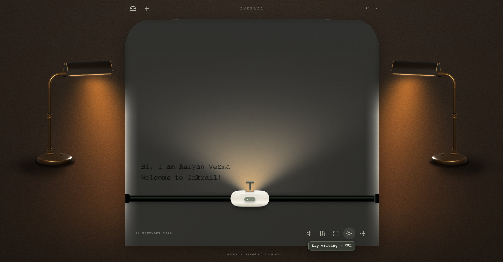

<div align="center">
  
  <h1>Inkrail</h1>
  <p><em>Paper, ink, and a little room to write.</em></p>
  <p>A quiet, native writing desk for Mac. No accounts or subscriptions.</p>
  <p><strong>macOS 13+ · Offline · Open source</strong><br /></p>
</div>

🎥 View Video Demo ↓
<p align="center">
  <a href="https://youtu.be/VA_Nj2Ip_BQ">
    
  </a>
</p>

<details>
  <summary>📸 View Screenshots / Gallery</summary>
  
  ##### Light Mode
  

  ##### Night View
  

  ##### Night View with Lamp
  

  ##### Customization
    
</details>

## Make yourself at home

Textured paper. A small moving typewriter. Warm lamps and optional mechanical
sounds. Open **Make it yours (⌘,)** to choose your paper, typeface, ink and desk.
Switch to **Focus Mode** for a wider page and quieter surroundings.

## Start writing

Have **Inkrail.app**? (Download from Releases) Drag it into **Applications** and open it.

Building from source requires Apple's Swift 5.9+ developer tools. Double-click
**Launch.command**, or run:

```bash
bash scripts/build-app.sh
open dist/Inkrail.app
```

This preview is not notarized by Apple. See [setup & troubleshooting](docs/DEVELOPMENT.md#start-on-your-mac).

| At your desk | Shortcut |
| :--- | :--- |
| New letter | ⌘N |
| Letter box | ⇧⌘O |
| Make it yours | ⌘, |
| Focus Mode | ⇧⌘F |
| Night writing | ⌥⌘L |
| Sound on / off | ⇧⌘M |
| Import text / Export text | ⌘O / ⇧⌘E |

Writing saves automatically; **⌘S** saves immediately. If a save fails, export
a copy before closing. **File → Export Markdown…** also saves your words as `.md`.

## Your letters

Your library stays on your Mac, with no cloud sync. Its default home is:

```text
~/Library/Application Support/Inkrail/
```

- **Find it:** choose **Writing → Show Local Files**.
- **Move it:** **Make it yours → Storage → Change Location…** copies the whole
  library to a new or empty folder. Future saves use that folder; the old copy stays intact.
- **Delete & restore:** use the trash icon in the letter box, then
  **Recently deleted → Restore** to bring a letter back within **30 days**.
  After that, it and its saved backup are permanently removed when Inkrail
  next checks. Existing deleted letters get a fresh 30-day window on first use
  of the updated app. Active letters and their backups are unaffected.

Keep a separate backup of your library. [Storage & recovery details →](docs/STORAGE.md)

## A work in progress

Native builds and targeted checks have passed.

In **Top** mode, the capsule may cover the next line while editing an earlier
paragraph. Scroll to reveal it, or use **Bottom** mode.

## Inspiration

<p>Highly inspired by <a href="https://apps.apple.com/in/app/platen-paper-ink/id6809529696">Platen — Paper &amp; Ink</a> app by Rafikki Studio for iOS.<br />

> Platen app was not built for macOS, so Inkrail fills that gap with extra features. Not sponsored by Platen.

---

<div align="center">
  <p>Made with ❤︎ by <strong><a href='https://linkedin.com/in/aaryanverma' target='_blank'>Aaryan Verma</a></strong></p>
  An independent project.</p>
  <p><a href="LICENSE">MIT License</a> · <a href="docs/DEVELOPMENT.md">Development</a></p>
</div>
